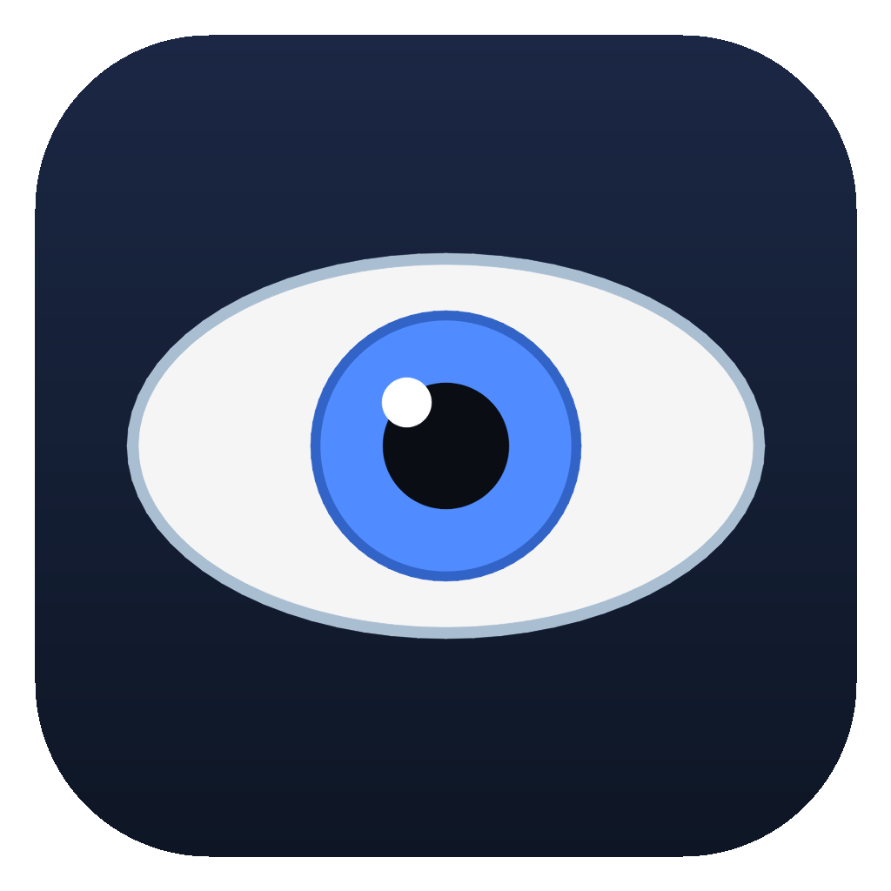

[](https://doi.org/10.5281/zenodo.24502739)

<p align="center">
  
</p>

<h1 align="center">Webcam Eye Tracker</h1>

<p align="center">
  <b>Turn your webcam into an eye tracker: gaze heatmaps and CSV data from a regular webcam, no extra hardware.</b><br>
  Local, private, one click to start. Ships with a macOS app build.
</p>

<p align="center">
  
  
  
</p>

---

Click **Start Tracking**, look at any webpage for 0.5, 1, 1.5 or 2 minutes, and get a
**heatmap** of where you looked and a **CSV** of every gaze sample. Optionally record the
**mouse pointer** too and compare "where I looked" with "where I pointed".

<table>
  <tr>
    <td align="center"><br><sub>The local web UI</sub></td>
    <td align="center"><br><sub>Example heatmap (synthetic data, for illustration)</sub></td>
  </tr>
</table>

## Features

- **No extra hardware**: any webcam, via [MediaPipe Face Landmarker](https://ai.google.dev/edge/mediapipe/solutions/vision/face_landmarker) iris tracking
- **9-point calibration** (about 20 s), saved and reused
- **Session length**: 0.5 / 1 / 1.5 / 2 minutes
- **Start delay** (0 / 2 / 5 / 10 s) so you can switch to the page you want to study, or give a **URL to open first**
- **Optional mouse tracking**, with a gaze-vs-mouse comparison overlay
- **Heatmap PNG + CSV**, plus a **Download All (ZIP)** button
- **Private**: video never leaves your machine; the only network request is a one-time ~4 MB model download
- **macOS friendly**: double-click launcher and a buildable `.app`, with ready-made builds on the Releases page

## How accurate is it, honestly?

This is single-webcam, appearance-based gaze estimation (the same family as browser tools
like WebGazer.js), **not** infrared eye-tracking hardware. After calibration, sitting fairly
still in even lighting, expect roughly **1–3 cm** of error on a typical monitor. That is good
enough for "which region of the screen did I look at" heatmaps, but **not** for precise
fixation/saccade research. Head movement, glasses glare, backlight and sitting far from the
camera all make it worse.

## Quick start

### macOS

| Option | What to do |
|---|---|
| **Download the app** | Grab `WebcamEyeTracker-macOS-arm64.zip` (Apple Silicon) from the [**Releases**](../../releases) page, unzip, drag to *Applications*. |
| **Double-click launcher** | Install [Python 3.12](https://www.python.org/downloads/macos/), then double-click **`Start Eye Tracker.command`**. First run sets up a private `.venv` (a few minutes). |
| **Build the app yourself** | Double-click **`Build Mac App.command`** (about 5–10 min) and take `dist/Webcam Eye Tracker.app`. |

First launch: macOS will say the app is from an unidentified developer. **Right-click → Open**
(once), or run `xattr -cr "/Applications/Webcam Eye Tracker.app"`. Then click **Allow** on the
Camera prompt. The builds are only *ad-hoc signed* (this is a free, unsigned project); that is
fine for personal use.

Your results, calibration and the downloaded model are stored in
`~/Documents/WebcamEyeTracker/` (`data/`, `models/`, `app.log`). Click **Quit app** on the page to stop it.

macOS permissions: **Camera** (required) · **Screen Recording** (optional, only for using a screenshot as the
heatmap background) · **Accessibility / Input Monitoring** (only if mouse tracking returns nothing).

### Any OS, from source

```bash
git clone https://github.com/<your-user>/webcam-eye-tracker.git
cd webcam-eye-tracker
python -m venv .venv && source .venv/bin/activate     # Windows: .venv\Scripts\activate
pip install -r requirements.txt
python app.py
```

It picks a free local port, prints the address (e.g. `http://127.0.0.1:5057`) and opens your
browser. (Port 5000 is avoided on purpose: macOS uses it for AirPlay Receiver.) Linux may also need
`sudo apt install python3-tk` for the calibration window, and mouse tracking needs an X11 session.

## Usage

1. **Run Calibration**: a fullscreen window shows 9 dots, one at a time. Look at each until it
   moves on; keep your head still. Saved to `data/calibration.json` and reused until you move
   your webcam or seat.
2. Choose **session length**, **start delay**, an optional **page to open first**, and optionally
   tick **Also track mouse pointer position**, then click **Start Tracking**.
3. Look at your page while it records.
4. The results page shows the gaze heatmap (plus a mouse heatmap and a comparison image, red/yellow = gaze,
   blue/cyan = mouse, if enabled) with download buttons for each file and **Download All (ZIP)**.

### CSV columns

| Column | Meaning |
|---|---|
| `timestamp_s` | Seconds since tracking started |
| `screen_x`, `screen_y` | Estimated gaze point in screen pixels (blank if no face was detected) |
| `h_ratio`, `v_ratio` | Raw normalized iris position inside the eye (0.5 ≈ centered), for your own analysis |
| `face_found` | Whether a face was detected in that frame |
| `mouse_x`, `mouse_y` | Global mouse position (only if mouse tracking was enabled) |

### Command line (no browser)

```bash
python eye_tracker.py --preview                    # live iris-tracking overlay, no recording
python eye_tracker.py --calibrate                  # run just the calibration
python eye_tracker.py --track 60                   # record 60 s, save CSV + heatmap
python eye_tracker.py --track 60 --delay 5 --open-url https://example.com --track-mouse
```

## How it works

1. MediaPipe's Face Landmarker finds 478 face landmarks per frame, including the iris.
2. The iris position relative to the eye corners and eyelids gives two ratios (`h_ratio`, `v_ratio`).
3. Calibration fits a quadratic mapping from those ratios to screen coordinates by least squares.
4. Gaze points are binned, blurred and colour-mapped into a heatmap over a screenshot of your screen.

## Troubleshooting

- **Calibration window doesn't appear**: it runs in its own process (macOS only allows GUI windows on a
  process's main thread). Check Camera permission (System Settings → Privacy & Security → Camera), then try
  `python eye_tracker.py --calibrate` in a terminal; the web app picks up the saved calibration.
- **Camera permission was denied (macOS)**: re-enable it under System Settings → Privacy & Security → Camera,
  then restart the app.
- **The bundled app does nothing / closes**: read `~/Documents/WebcamEyeTracker/app.log`.
- **"Could not open webcam"**: close other apps using the camera (Zoom, Teams, other tabs), or pick another
  camera: `EYE_TRACKER_CAMERA_INDEX=1 python app.py` (Windows: `set EYE_TRACKER_CAMERA_INDEX=1 && python app.py`).
- **Heatmap background is plain gray**: screen capture was blocked (on macOS grant *Screen Recording*). The heatmap is still correct.
- **Low accuracy / scattered heatmap**: recalibrate, sit at your normal distance, light your face evenly
  (no strong backlight), keep your head still.
- **"Mouse tracking was requested but unavailable"**: needs `pynput` and OS permission (macOS Accessibility;
  Linux needs X11, not pure Wayland). The session still runs, just without mouse data.

## Privacy

Everything runs on your machine. No video frames, images or gaze data are sent anywhere. The only network
request is the one-time download of MediaPipe's face-landmark model from Google's public model storage.
Your recordings are never committed to git (see `.gitignore`).

## Development

```bash
pip install -r requirements-dev.txt
python -m pytest            # no webcam or network needed
```

- **CI** (`.github/workflows/ci.yml`) runs the tests on every push and pull request.
- **Releases**: push a tag such as `v1.0.0` and `.github/workflows/build-mac-app.yml` builds the macOS app
  on GitHub's Macs and attaches the zips to a Release. It can also be started by hand from the *Actions* tab.

```bash
git tag v1.0.0 && git push origin v1.0.0
```

### Project structure

```
├── app.py                      # Flask web UI + job orchestration
├── eye_tracker.py              # Tracking engine (camera, calibration, heatmap) + CLI
├── templates/  static/         # Web UI
├── tests/                      # Hermetic smoke tests
├── Start Eye Tracker.command   # macOS: double-click to run
├── Build Mac App.command       # macOS: builds "Webcam Eye Tracker.app"
├── EyeTracker.spec             # PyInstaller recipe (camera-permission text lives here)
├── make_icon.py  icon.png      # App icon
├── docs/                       # README images
└── .github/workflows/          # CI + macOS release build
```

## License

[MIT](LICENSE). Built on [MediaPipe](https://github.com/google-ai-edge/mediapipe) (Apache-2.0),
[OpenCV](https://opencv.org/), [Flask](https://flask.palletsprojects.com/), [pandas](https://pandas.pydata.org/)
and [pynput](https://github.com/moses-palmer/pynput).
